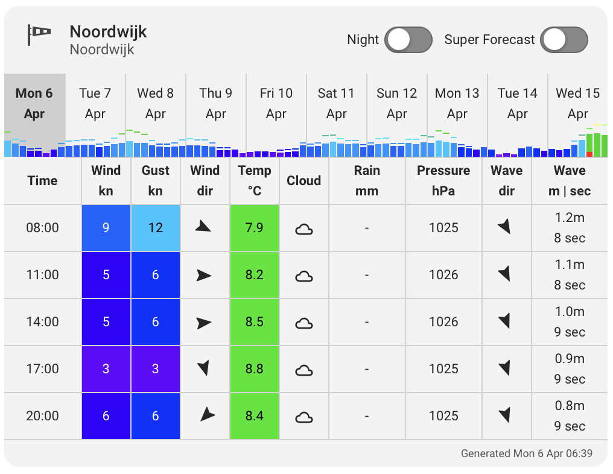

# Windfinder Home Assistant Integration

A custom integration that fetches wind and weather information from [windfinder.com](https://www.windfinder.com) and exposes it as sensors in Home Assistant.

## Installation

### No HACS
1. Copy `custom_components/windfinder` from this repository to your Home Assistant `config/custom_components/windfinder` directory.
2. Restart Home Assistant.
3. From the integrations page or via HACS, add **Windfinder** and provide your desired location. The location is normalised to lower case.

### With HACS
1. add a new custom repo, use https://github.com/jtonk/ha_wf/ repo and the integration category
2. search for Windfinder in HACS & install it
3. restart Home Assistant
4. From the integrations page or via HACS, add **Windfinder** and provide your desired location. The location is normalised to lower case.

The integration fetches once on startup or reload. After that it schedules the next refresh for 5 minutes after the earliest `next update` timestamp reported by the forecast or superforecast page. The sensor state is recalculated hourly from the fetched forecast data.

### Integration icon
The official Windfinder icon is bundled in `custom_components/windfinder/brand/icon.png`.
Home Assistant 2026.3 or newer displays this icon automatically. After updating
the integration, restart Home Assistant and refresh your browser to load it.
Older Home Assistant versions do not support bundled integration icons.

The icon comes from [Windfinder's website](https://www.windfinder.com/about/history-press)
([original asset](https://cdn.windfinder.net/prod/assets/apple-touch-icon-prod.BCBndhaW.png))
and remains the property of Windfinder; it is not covered by this project's MIT license.

## Usage
For each configured location a sensor and a refresh button are created. The sensor's state reports the predicted wind speed in knots for the active forecast hour, preferring `superforecastdata` when available and falling back to `forecastdata`. The full forecast data and update timestamps are available in the sensor attributes.

The forecast attributes remain available on the live entity but are excluded
from recorder history. This prevents the large forecast arrays from exceeding
Home Assistant's recorder attribute-size limit and allows long-term wind-speed
statistics to be compiled reliably.

To trigger an immediate update you can call the `windfinder.refresh` service:

```yaml
service: windfinder.refresh
data:
  entity_id: sensor.windfinder_noordwijk
```

## Sensor Attributes
- `forecastdata` / `superforecastdata` – hourly forecast points with `datetime` and `tide_datetime` stored as UTC ISO timestamps.
- `forecast_generated` / `superforecast_generated` – last update timestamps reported by Windfinder, stored in UTC.
- `forecast_last_update` / `superforecast_last_update` – explicit aliases for the last update timestamps, stored in UTC.
- `forecast_next_update` / `superforecast_next_update` – next update timestamps reported by Windfinder, stored in UTC.
- `forecast_fetched` / `superforecast_fetched` – timestamps for when Home Assistant fetched the page, stored in UTC.
- `spot_name` – the name of the location returned by Windfinder.
- `spot_timezone` – the spot's IANA timezone identifier reported by Windfinder, for example `Europe/Amsterdam`.

Forecast measurements are rounded to practical display precision: wind,
temperature, rain, and wave period to one decimal; wave and tide heights to two
decimals; and directions, percentages, humidity, and pressure to whole numbers.
The sensor state is rounded to one decimal knot.

## Windfinder dashboard card

The integration includes the former `ha_wf_card` card. It registers the card as a
Lovelace resource automatically in storage resource mode. YAML resource mode also
loads the card automatically. No second HACS repository or JavaScript download is
needed.

Add it to a dashboard with the existing card type:

```yaml
type: custom:ha-wf-card
entity: sensor.windfinder_noordwijk
title: Noordwijk
show_night: false
default_source: forecastdata
alert:
  speed_min: 15
  angles:
    - from: 0
      to: 30
    - from: 210
      to: 360
```

The visual editor supports entity selection, title, forecast source, night
visibility, and alert speed and direction ranges. Times use the sensor's
`spot_timezone` when available. The card reads the entity's `icon` attribute.



### Card options

- `entity` (required): a Windfinder sensor with forecast attributes.
- `title`: optional card title.
- `show_night`: show night hours when `true`.
- `default_source`: `forecastdata` (default) or `superforecastdata`.
- `alert`: highlight wind above `speed_min` knots in the `angles` ranges during daylight hours.

In a sections view, the card reports a full-width 12-column layout and adjusts
its height to the visible forecast rows. Leave `grid_options.rows` unset to keep
that automatic height.

### Migrating from the separate card

After updating this integration and restarting Home Assistant, remove the old
`ha_wf_card` HACS repository and its `/hacsfiles/ha_wf_card/ha_wf_card.js`
Dashboard resource. Keep your dashboard cards: `type: custom:ha-wf-card` and all
card options are unchanged. Refresh the browser after removing the old resource
so it loads the bundled version.

## License
MIT
